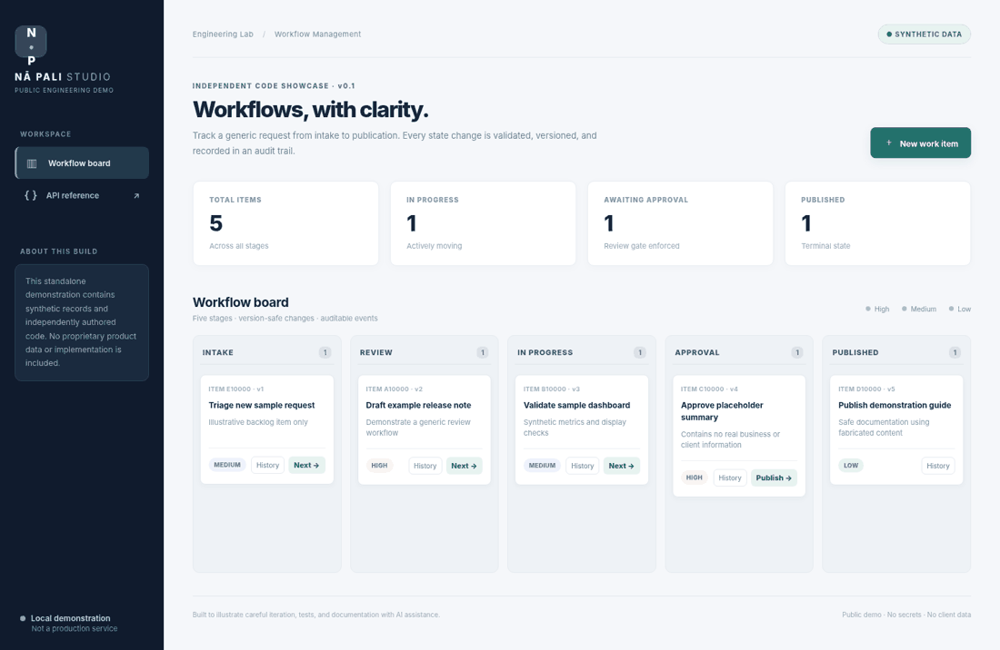

# Nā Pali Studio · Public Engineering Demo

> **Independent demonstration, not the private Nā Pali Studio application.** This repo was newly created as a sanitized portfolio sample. Its records, workflow, data model, UI, and test fixtures are synthetic. It contains no private application source code, client information, proprietary publications, production configuration, or credentials.



## What this shows

A runnable example of a small operational workflow, constructed with AI-assisted development and reviewed through tests and browser checks. It illustrates how I approach incremental software delivery: make a thin working slice, capture decisions in docs, validate behavior, and make unsafe state changes fail predictably.

- **Full-stack functional demo:** FastAPI/SQLite service and a responsive, dependency-light browser interface.
- **Defensive workflow logic:** explicit permitted transitions, approval stage, and terminal publication state.
- **Concurrency awareness:** version checks reject stale changes (`409 Conflict`) instead of silently overwriting work.
- **Auditability:** each new item and workflow change produces an immutable event record within the same transaction.
- **Operational hooks:** `/healthz`, `/readyz`, `/api/metrics`, JSON API, and interactive `/docs` OpenAPI reference.
- **Delivery discipline:** pytest suite, CI matrix, container setup, contributor instructions, and privacy checks.

**Why a small demo?** The actual private Nā Pali Studio is a larger internal technology-advisory platform. This deliberately independent example demonstrates engineering practices without exposing proprietary details. It is not a code extraction or sanitized copy of the real system.

## Quick start

Prerequisite: Python **3.11+**. Do **not** serve this local-only demo on a public interface; it has no authentication.

```bash
python -m venv .venv
source .venv/bin/activate      # Windows: .venv\Scripts\activate
python -m pip install -e '.[dev]'
uvicorn app.main:app --host 127.0.0.1 --port 8000
```

Open [http://127.0.0.1:8000](http://127.0.0.1:8000). The first run seeds five **fabricated** sample items. Use **New work item**, **Next**, and **History** to explore the workflow. The local database is created in `.data/workflows.sqlite` and is ignored by Git.

Run tests and validations:

```bash
pytest
ruff check app tests
python scripts/check_public.py
```

Docker option, published **only to your loopback interface**:

```bash
docker compose up --build
# browse http://127.0.0.1:8000
```

Optional visual browser smoke test uses mocked API responses and does not replace the backend tests. After installing `.[browser]` and Playwright Chromium, run `python scripts/browser_check.py`.

For an empty starting database, set `DEMO_SEED=false`. Use `DEMO_DB_PATH` to select a separate SQLite database path.

## API at a glance

| Method | Path | Description |
|---|---|---|
| `GET` | `/api/work-items` | List synthetic work items |
| `POST` | `/api/work-items` | Create with title, description, priority |
| `GET` | `/api/work-items/{id}` | Read one item |
| `POST` | `/api/work-items/{id}/transition` | Transition with `expected_version` |
| `GET` | `/api/work-items/{id}/events` | Read auditable state history |
| `GET` | `/api/workflow` | Allowed state changes |
| `GET` | `/api/metrics` | Work-item counts per stage |
| `GET` | `/healthz`, `/readyz` | Local health and readiness |
| `GET` | `/docs` | Interactive API documentation |

Example safe transition (replace `<id>` with an item ID):

```bash
curl -X POST http://127.0.0.1:8000/api/work-items/<id>/transition \
  -H 'Content-Type: application/json' \
  -d '{"to_status":"review","expected_version":1,"note":"Sample review"}'
```

## Workflow and design

```text
Intake → Review → In progress → Approval → Published
           ↖────────┘         ↖────────┘
     Review may return to Intake. In progress may return to Review.
     Approval may return to In progress. Published is terminal.
```

See [architecture and tradeoffs](docs/ARCHITECTURE.md), [AI-assisted development record](docs/AI_DEVELOPMENT.md), and [security boundaries](SECURITY.md).

## How AI was used

This demonstration was built with ChatGPT as an **AI coding collaborator** in October 2026. Human-provided goals and privacy constraints shaped the scope; generated code was exercised using a test suite, browser interactions, and manual review. The accompanying [AGENTS.md](AGENTS.md), [CLAUDE.md](CLAUDE.md), and [SKILL.md](SKILL.md) specify constraints and repeatable validation steps.

The repository's commits show the actual **new demo construction sequence**, not historical private Nā Pali Studio development. The commit author is identified as an AI-assisted demo builder to avoid misattributing code. The project owner should review and approve each change before publication. There is no claim that a model performed autonomous security or production validation.

## Limits and privacy

This is an educational **local development demo**, not production-ready software. It intentionally omits authentication, authorization, multi-tenant isolation, rate limiting, CSRF hardening, persistent backup/restore, and production monitoring. It should **not** be deployed publicly as a live multi-user service. The public GitHub **source repository** can be shared; the running server should remain local.

All examples are fabricated. The code was written independently for this sample; it is not a redacted dump of the private project. See [SECURITY.md](SECURITY.md) and the [LICENSE](LICENSE).
