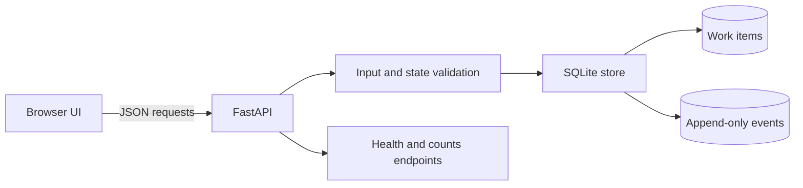

# Architecture & engineering decisions

## Dependency-light data flow

- The browser renders API response text with `textContent`, not `innerHTML`.
- Pydantic validates title length, priority, and bounded notes.
- Allowed transitions are explicit in `app/storage.py` and read by the UI through `/api/workflow`.
- SQLite `BEGIN IMMEDIATE` serializes write transactions for this small local deployment.
- `expected_version` protects against a stale browser updating a newer item. A mismatch returns `409`.
- The work-item state change and event insertion are committed together, keeping the audit log aligned.
- The demo exposes small local service health endpoints without implying production monitoring.

## Tradeoffs

| Decision | Reason for demo | Production alternative |
|---|---|---|
| SQLite | Fully local and testable | Managed DB, migrations, backups |
| Vanilla JS | Very easy to run and review | Framework where justified |
| Five-stage workflow | Shows a state machine without revealing private process | Business-specific authorized rules |
| Synthetic sample seed | Self-explanatory UI on first run | No fabricated records in production |
| `demo-user` actor | No actual identity handling | Authenticated user with server-side RBAC |
| No external AI API | AI is used in **development**, not pretending to power runtime inference | Audited API integration only if justified |

## Known limitations

This application has no authentication, authorization, tenancy checks, API rate limiting, CSRF protections, structured production telemetry, backups, or deployment hardening. The audit log is append-only through the sample application interface but is not tamperproof against a database administrator. Do not publish the live server to the public internet.

## Review questions

1. Is the state machine explicit and verifiably enforced?
2. Does a simultaneous stale update fail with a helpful error?
3. Do audit records align with committed state changes?
4. Can a reviewer run tests with one command and inspect API docs?
5. Is every example independent of real client and company data?
